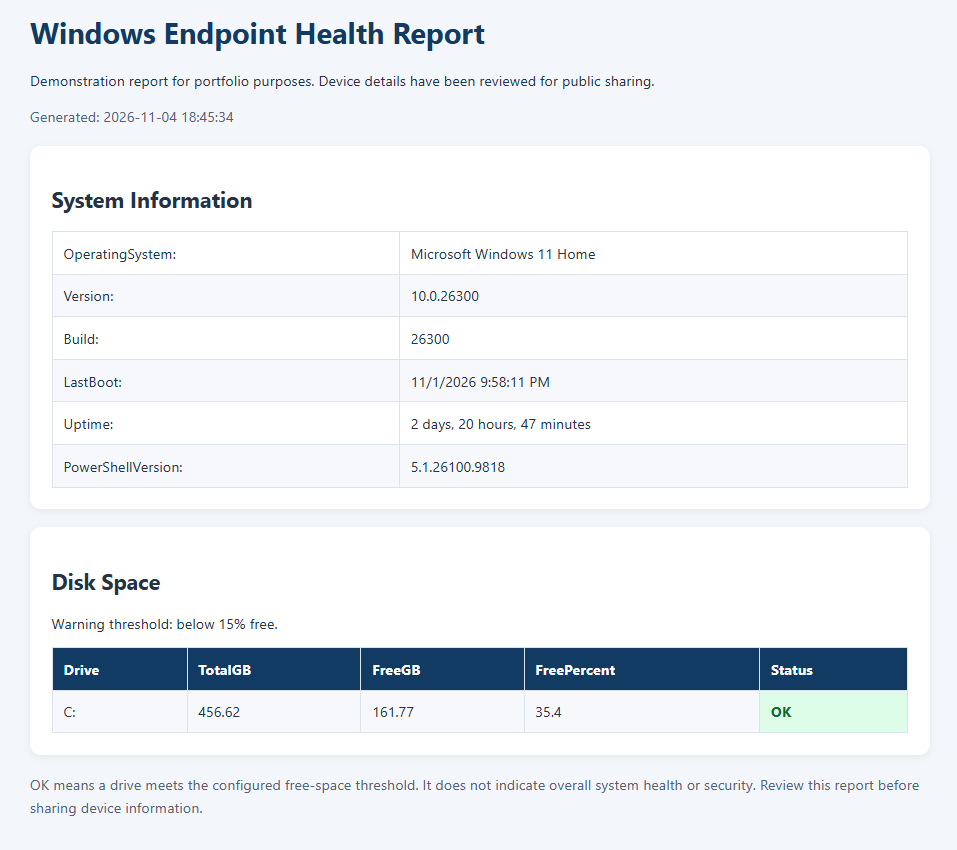

# Windows Endpoint Health Checker

A PowerShell diagnostic tool designed to collect Windows endpoint
health information and generate readable reports.

## Project Status

In development. Features will be marked complete after implementation
and testing.

## Problem

IT support technicians often check several tools to collect basic
device information during troubleshooting.

This project aims to bring common checks into one repeatable workflow.

## Planned Features

- [x] Collect Windows version and build information
- [ ] Calculate system uptime
- [ ] Check available disk space
- [ ] Collect network and DNS configuration
- [ ] Check selected Windows services
- [x] Export an HTML report
- [ ] Export structured JSON results
- [ ] Add automated tests and sample output

## Design Goals

- Collect diagnostic information without changing system settings
- Explain warnings clearly
- Handle unavailable checks without stopping the entire report
- Keep configuration separate from diagnostic logic
- Avoid collecting credentials or unnecessary personal information

## Technologies

- PowerShell
- Windows
- HTML
- JSON

## Getting Started

Setup instructions and supported PowerShell versions will be added
after the first working version is tested.

## Sample Output

A sanitized example report will be added to the examples folder.

## Limitations

This tool is intended for troubleshooting and learning.
It is not a vulnerability scanner or a security compliance assessment.

## Privacy

Generated reports may contain device and network information.
Review and sanitize reports before sharing them.

## Sample Report

The tool generates an HTML report containing Windows system
information and disk-space results.

The example below has been reviewed for public sharing.

[View the sample HTML source](examples/sample-report.html)

To view the HTML report as a webpage, download the sample file
and open it in a browser.

## Manual Testing

| Test | Expected Result | Actual Result |
|------|-----------------|---------------|
| Default run | System and disk information displayed | Pending |
| HTML export | Report created and opens in browser | Pending |
| Custom threshold of 99% | Drives below 99% free show WARNING | Pending |
| Default threshold | Warning threshold returns to 15% | Pending |

## Roadmap

1. Implement basic system and disk checks.
2. Add network and service checks.
3. Build report exports.
4. Add error handling and automated tests.
5. Publish a tested first release.
